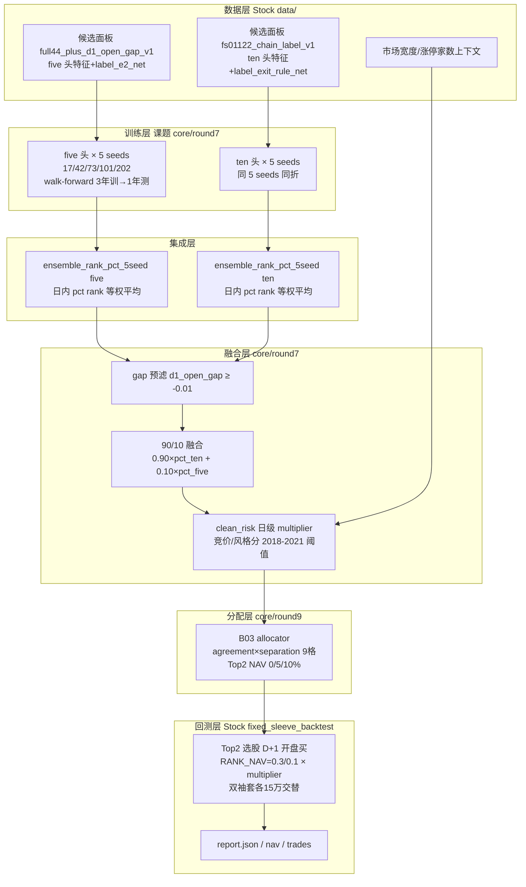

# 一进二策略 · 多 Seed 集成（Multi-Seed Ensemble）全流程

> 撰写日期：2026-10-14。调查范围：`/home/mxy/Stock`（实路径 `/data1/stock-mxy`，两者为同一目录的符号链接）下 `src/first_board_hermes`、`tools/`、`runs/`、`data/`，以及课题目录 `/home/mxy/Stock/课题/一进二策略/`（实路径 `/data1/stock-mxy/课题/一进二策略`）的 `core/`、`scripts/`、`result/`、`docs/`。
> 本文所有数字均引自落盘的 `report.json` / `conclusion.json` / 追踪表 / 源码行号；未能确认的内容在文末「未确认事项」中单独列出，不做臆测。

---

## 1. 概述

「一进二」策略在 **D 日收盘确认"硬首板"** 的股票池上，用 D 日（及 D+1 09:25 竞价）可得的因子训练 XGBoost 排序器，给每只候选股的次日溢价打分；**D+1 开盘买入**当日分数最高的 Top2，**D+2 起第一个未涨停收盘卖出**（见 `docs/数据与策略详解.md` 第 41 行策略定义）。

**多 Seed 集成**指的是：同一特征集、同一标签、同一超参，仅用 5 个不同 `random_state`（**17, 42, 73, 101, 202**）各训一个模型，再把 5 个模型的逐日预测按「日内百分位排名的等权平均」合成一个分数，产物名固定为 **`ensemble_rank_pct_5seed`**。其动机是降低单模型对随机性的敏感度——在因子搜索时代（subsample=0.8 的真 bagging），单 seed 之间年化收益可差一倍以上（见 §8.1）。

当前锁定的生产形态（截至 Round16 交接）是**「双头五 Seed 集成」**：

- **alpha 头（five 头）**：FS01122 十四因子 + `label_e2_net`，日内 5 档相关度，5 seed 集成；
- **风险头（ten 头）**：十三因子（=five 去掉 `g0_amount_log`）+ `label_exit_rule_net`，日内 10 档相关度，5 seed 集成；
- 两头集成分按 **90/10** 融合（`score = 0.90 × pct_ten + 0.10 × pct_five`），预滤 `d1_open_gap ≥ -0.01`；
- 再经 **clean_risk 日级仓位层**与 **B03 allocator**（RANK_NAV = 0.3 / 0.1，Top2 双袖套）进入正式回测。

出处：`result/round16/ROUND17_RESEARCH_HANDOFF.md`、`result/round7/contract.json`、`result/一进二_Round7基线_实验组追踪.md` 第 6/18 行。

> **命名注意**：Round16 交接文档把 five 头称作「fs00263（alpha 头）」，但 Round7 冻结契约里 five 头实际使用 **FS01122 的 14 个特征**（`result/round7/contract.json` 第 5-26 行）。`fs00263` 严格说是 5000 组因子搜索时代的 **6 因子旧 Top1 线**的试验代号（`result/一进二_最优实验组追踪.md` 第 28 行），此处属 lineage 上的宽松叫法。另外「ten 头」的「ten」指 **10 档相关度分箱**（`rank_n_bins=10`），不是 10 个 seed 或 10 个子模型。

---

## 2. 整体流程图



管线分两条历史线演进（详见 §8）：

| 阶段 | 时间 | 特征/标签 | 采样 | 组合 | 产物 |
|---|---|---|---|---|---|
| 因子搜索 fs00263 | 2026-09 上旬 | 6 因子 / label_exit_rule_net | **0.8/0.8 真 bagging** | 单头 5seed 集成，Top1 30% NAV | `runs/first_board_factor_search_5000_v1/` |
| fs01122 Top2 | 2026-09 中旬 | 13~14 因子 / label_e2_net | **0.8/0.8** | 单头 5seed + gap 预滤，Top2 25/15 | `runs/first_board_fs01122_d1_open_gap_v1/` |
| Round7 双头（现行） | 2026-09-28 起 | five=14 因子 e2 / ten=13 因子 exit_rule | **1.0/1.0（禁采样）** | 双头各自 5seed 集成 → 90/10 融合 → clean_risk → B03，Top2 30/10 | `result/round7/` … `result/round9/` |

---

## 3. 训练阶段

### 3.1 训练脚本与调用链

**现行（Round7 起，课题侧 canonical）**：

- 入口脚本：`scripts/run_round7.py`（管线 stage：`scaffold → train → blend → risk → backtest → compare → conclude`，见脚本第 22 行 `STAGES`）。
- 训练实现：`core/round7/train.py` 的 `train_head()`（第 105 行起）对每个 seed 调用 **Stock 包** `first_board_hermes.baseline.rolling_train_predict`（`/home/mxy/Stock/src/first_board_hermes/baseline.py` 第 245 行），逐 seed 落盘后由 `ensemble_rank_pct()`（`core/round7/train.py` 第 81-102 行）合成。
- 训练约束写死在 `core/round7/contract.py` 的 `model_parameters()`，并在 `AGENTS.md` 第 18 行作为硬规则：「XGBoost 训练关闭 `subsample` / `colsample_bytree`（必须 `1.0`）；不要改 Stock 已训完的 fs00263 / fs01122」。

**历史（Stock 侧，只读）**：

- 5000 组因子搜索：`/data1/stock-mxy/tools/run_first_board_factor_search_5000.py`（确切命令行参数未找到，见文末未确认事项；产物与契约在 `runs/first_board_factor_search_5000_v1/registry/trials.json`）。
- Seed 集成构建：`/data1/stock-mxy/tools/build_first_board_seed_ensemble.py`（第 42 行 docstring：*"Build the canonical five-seed daily percentile-rank ensemble."*）。
- 双头混合（等权 50/50 版）：`/data1/stock-mxy/tools/blend_first_board_rank_predictions.py`。

### 3.2 Walk-Forward 折法（Stock 引擎，`baseline.py`）

`rolling_train_predict`（`src/first_board_hermes/baseline.py` 第 245-499 行）的折叠逻辑：

- **严格按日历年**：用「预测年之前恰好 3 个日历年」的数据训练，预测下一个日历年（如 2015-2017 训 → 2018 测），逐年滚动，预测覆盖 2018-2026 共 9 折；
- **PIT 标签截止**：训练样本要求 `label_end_column` 的年份 ≤ 训练截止年（第 312 行 `training[label_end_column].dt.year.le(train_end)`），即标签必须在训练窗内已成熟，杜绝未来函数；
- 标签相关度由 `daily_relevance()`（第 140 行）做**日内等频分箱**（`rank_n_bins` 档，0..n-1 序数），模型为 `XGBRanker`，`eval_metric` 按头分别取 `ndcg@1` / `ndcg@2`；
- 每折模型以 JSON 落盘在 `result/round7/models/<head>/seed<seed>/` 下。

样本区间：开发窗 DEV = 2018-01-01 ~ 2021-12-31（`core/round7/contract.py` 第 12-13 行），信号区间 2018-01-01 ~ 2026-06-01，行情至 2026-07-24（`core/paths.py`：PREDICTION_START / SIGNAL_END / MARKET_END；快照 `hermes-cn-a-2010-20260724-v7-all-features`）。

### 3.3 双头特征集与标签（Round7 冻结契约）

出处：`result/round7/contract.json` 与 `core/round7/contract.py`。

| 项 | five 头（alpha） | ten 头（风险/退出） |
|---|---|---|
| 训练面板 | `data/first_board_hermes/aligned_original_candidate_full44_plus_d1_open_gap_v1` | `data/first_board_hermes/aligned_original_candidate_fs01122_chain_label_v1` |
| 特征数 | **14**（含 `d1_open_gap`） | **13**（= five 去掉 `g0_amount_log`） |
| 标签 target | `label_e2_net`（D+2 起首个可卖收盘的净收益） | `label_exit_rule_net`（按退出规则实际退出日净收益） |
| 标签成熟列 | `next2_date` | `actual_exit_date` |
| 日内相关度分箱 | **5 档**（`rank_n_bins=5`） | **10 档**（`rank_n_bins=10`） |
| eval_metric | `ndcg@1` | `ndcg@2` |

five 头 14 特征（contract.json 顺序）：
`g_prim_px_vol_corr, fb_close_seal_streak_norm, fb_last30_amount_ratio, h5_last_first_limit_value_change_sym, h1_consistent_buy_ratio, h1_last15m_volume_ratio, h4_large_net_to_turnover, h4_retail_net_to_turnover, g0_amount_log, g0_amt_vs_5, g1_ret_5, g3_days_since_limit, ind_seal_rate_excess, d1_open_gap`。
ten 头 13 特征 = 上表去掉 `g0_amount_log`（contract.json 第 28-44 行）。

> 语义提示：`d1_open_gap` 是 D+1 09:25 才知道的竞价跳空，属「次日信息」。Round7 结论明确标注执行告警（`result/round7/conclusion.json` `execution_warning`）：研究用 D+1 同开盘价成交，数字不得直接当作可实盘表现。这与 fs00263 旧线（纯 D 收盘特征）不可混比（`result/replay_fs01122/00_parity.md` 末尾"已知语义差"）。

### 3.4 模型超参与 Seed 列表

Round7 冻结超参（`core/round7/contract.py` `model_parameters()`；`result/round7/contract.json` 第 55-70 行）：

```text
objective          = rank:ndcg
ndcg_exp_gain      = true
n_estimators       = 100
learning_rate      = 0.05
max_depth          = 2
min_child_weight   = 1.0
subsample          = 1.0        # 硬规则：禁止 < 1.0
colsample_bytree   = 1.0        # 硬规则：禁止 < 1.0
reg_lambda         = 1.0
reg_alpha          = 0.0
tree_method        = hist
n_jobs             = 2
random_state       = seed
```

**Seed 列表（两头相同）**：`SEEDS = (17, 42, 73, 101, 202)`（`core/round7/contract.py` 第 11 行）。该列表自 5000 组搜索时代沿用（`docs/数据与策略详解.md` 第 539 行：「5,000 组，seed (17,42,73,101,202)」）。

### 3.5 历史配方的演变（为什么会有"禁采样"规则）

| 阶段 | 超参差异 | 出处 |
|---|---|---|
| fs00263（搜索时代） | `n_estimators=50, max_depth=2, ndcg@3, 5 档, label_exit_rule_net, **subsample=0.8, colsample_bytree=0.8**`，容量 n50_d2 | `runs/first_board_factor_search_5000_v1/predictions/n50_d2/seed17/fs00263/training_report.json` |
| fs01122（Stock run） | `n_estimators=100, ndcg@1, 5 档, label_e2_net, 14 特征, **subsample=0.8, colsample_bytree=0.8**`，容量 n100_d2 | `runs/first_board_fs01122_d1_open_gap_v1/predictions/n100_d2/seed17/training_report.json` |
| Round7 canonical（现行） | 100 树、双头双标签、**subsample=1.0, colsample_bytree=1.0** | `result/round7/contract.json` |

禁采样的依据来自 Round6 复现取证（`result/round6/01_reproducibility_forensics.md`）：

- 受控替换 waterfall：冻结 v3 覆盖层下 CAGR 23.86%（`R6_A00`）→ 换 `label_e2_net` + 采样 1.0 后 10.94%（`R6_A01`）→ 冻结 universe 重训 18.34%（`R6_A02/A03`）→ **仅把采样改回 0.8/0.8 就得 23.09%（`R6_A04`），+4.75% CAGR 全部来自 bagging 随机性**，被标记为 `FORENSIC_ONLY，不得当晋升候选`；
- 即：0.8/0.8 采样带来的增益不可稳定复现（seed 间方差大，见 §8.1），因此冻结 canonical 配方为 `subsample=1.0, colsample_bytree=1.0`（同文件第 50 行配方串），并以项目规则形式固定（`AGENTS.md` 第 18 行、`.cursor/rules/no-xgb-subsample.mdc`）。

### 3.6 关键事实：现行「5 Seed 集成」在训练侧是退化的

`tree_method=hist` 且不采样（subsample=colsample_bytree=1.0）时，XGBoost 训练是**完全确定性**的，`random_state` 不再影响结果。因此 Round7 起 5 个 seed 的预测**逐行相同**：

- `result/round7/models/five/ensemble_report.json`：`seed_rank_invariance.passed = true`，4 组两两比较 `mismatch_rows` 全为 0，`rows = 45256`，`days = 2038`，集成产物 `prediction_sha256 = 8518ae7f...`；
- `result/round7/models/ten/ensemble_report.json`：同样 `passed = true`，集成产物 `prediction_sha256 = 19416b41...`。

代码里用 `assert_seed_rank_invariance()`（`core/round7/train.py` 第 60-79 行）**强制断言**这一不变性——5 seed 排名必须完全一致，否则直接报错。也就是说：当前的「5 seed 集成」保留了集成的**结构、产物格式与名称**（向后兼容 Stock 账本口径），但数学上等价于单模型。真正的 bagging 集成只存在于 fs00263 / fs01122 的 Stock 历史产物里（那时的 5 个 seed 输入 sha256 互不相同，见 §4.2、§8.1）。

---

## 4. 预测生成与落盘

### 4.1 课题侧（现行）

- 每 seed 原始预测：`result/round7/models/<five|ten>/seed<17|42|73|101|202>/predictions.parquet`，附 `training_report.json`（逐折模型与 ndcg 指标）；模型本体 JSON 同目录。
- 集成预测：`result/round7/models/<five|ten>/predictions.parquet` + `ensemble_report.json`。
- 融合预测：`result/round7/predictions/dual90_10_gap_floor/predictions.parquet`（+ `report.json`）。
- 风险层预测：`result/round7/predictions/clean_risk/predictions.parquet`（在融合分基础上**逐行附加 `allocation_multiplier` 列**，+ `daily_state.parquet` 日级状态）。
- 后续轮次（Round8/9/…）只读复用 `result/round7` 的锁分（`core/round8/geometry.py` 的 `load_head_ensembles()` 第 60 行起，从 `result/round7/models/<head>/predictions.parquet` 重新推导融合分），不重新训练。

Parquet 字段约定：集成分文件为 `signal_date, instrument_id, score`（`build_first_board_seed_ensemble.py` 第 67-71 行；`core/round7/train.py` 第 97-102 行）；风险层文件额外含 `allocation_multiplier`。键唯一性有硬校验（重复键直接 `RuntimeError`）。

### 4.2 Stock 侧（历史，只读）

- 每 seed：`runs/<run>/predictions/<capacity>/seed<seed>/[trial_id/]predictions.parquet`，如 `runs/first_board_fs01122_d1_open_gap_v1/predictions/n100_d2/seed17/predictions.parquet`。
- 集成：`runs/first_board_factor_search_5000_v1/ensembles/n50_d2/ensemble_rank_pct_5seed/fs00263/predictions.parquet`，其 `ensemble_report.json` 记录 5 个输入的 sha256——**互不相同**（17=`ead23a38…`、42=`db69b175…`、73=`0be847c1…`、101=`e7566fe0…`、202=`6c101b7e…`），证明当时是 0.8/0.8 采样的真 bagging；诊断量 `pairwise_daily_top3_jaccard_median = 0.5`、mean = 0.6076（5 个 seed 的日 Top3 集合 Jaccard 中位数仅一半）。
- gap 预滤产物：`runs/first_board_fs01122_d1_open_gap_v1/ensemble_prefilter_gap_floor/`（`filter_report.json`：`minimum=-0.01`，46048 → 38658 行，决策时点 "D+1 09:25 after opening call auction"）。
- 双头探索产物：`runs/first_board_fs01122_dual_bin_role_mix_v1/`（`ten_first_five_second` 等 4 种组合 × 多组 RANK_NAV）、`runs/first_board_fs01122_d1_open_gap_label_blend_v1/`（50/50 等权 blend 与 five 单头对照）。

---

## 5. 集成组合方式（精确公式 + 代码引用）

### 5.1 `ensemble_rank_pct_5seed`：5 seed 日内百分位等权平均

Stock 侧实现：`/data1/stock-mxy/tools/build_first_board_seed_ensemble.py` 第 30-71 行；课题侧复刻：`core/round7/train.py` 第 81-102 行（函数 `ensemble_rank_pct`）。两者逻辑完全一致，步骤：

1. **逐 seed 日内百分位排名**：每个 seed 的预测按 `signal_date` 分组，对 `score` 做 `rank(method="average", pct=True)`（并列取平均名次，结果 ∈ (0,1]）。`build_first_board_seed_ensemble.py` 第 52-54 行：

```python
frame[f"rank_{seed}"] = frame.groupby("signal_date")["score"].rank(
    method="average", pct=True
)
```

2. **5 seed 严格内连接对齐**：以 `(signal_date, instrument_id)` 为键 inner join（`validate="one_to_one"`），且强制恰好 5 个预注册 seed、各 seed 样本宇宙一致，否则报错（同文件第 56-66 行）。
3. **等权平均**：`score = mean(rank_17, rank_42, rank_73, rank_101, rank_202)`（第 68 行 `ensemble["score"] = merged[rank_columns].mean(axis=1)`）。
4. **确定性排序**：按 `signal_date` 升序、`score` 降序、`instrument_id` 升序稳定排序（第 69-71 行），保证同分时次序确定。

用公式写（对第 d 日、股票 s、seed i）：

\[
\mathrm{pct}_{i}(d,s)=\mathrm{rank}_{\mathrm{pct}}\big(\mathrm{score}_{i}(d,\cdot)\big)(s),\qquad
\mathrm{ensemble}(d,s)=\frac{1}{5}\sum_{i\in\{17,42,73,101,202\}}\mathrm{pct}_{i}(d,s)
\]

报告中的方法串固定为 `"equal mean of within-day percentile ranks"`（第 137 行；各 `ensemble_report.json` 均可核对）。

### 5.2 90/10 双头融合（Round7 新增，课题侧）

实现：`core/round7/blend.py` 的 `fuse_predictions()`（第 29-47 行）。步骤（亦见产物 `result/round7/predictions/dual90_10_gap_floor/report.json` 的 `ordering` 字段，第 75-81 行）：

1. five / ten 两个**集成后**的预测按 `(signal_date, instrument_id)` inner join（宇宙必须一致）；
2. 并入候选面板的 `d1_open_gap`，**只保留 finite 且 ≥ -0.01 的行**（`GAP_FLOOR = -0.01`，`core/round7/contract.py` 第 14 行）——竞价低开的票在排序前就剔除；
3. 在筛选后的宇宙内，两头各自再做一次**日内百分位重排** `pct_five` / `pct_ten`（第 37-38 行）；
4. 加权融合（第 39 行）：

```python
work["score"] = TEN_WEIGHT * work["pct_ten"] + (1.0 - TEN_WEIGHT) * work["pct_five"]
```

其中 `TEN_WEIGHT = 0.90`（`core/round7/contract.py` 第 15 行），即：

\[
\mathrm{fused}(d,s)=0.90\times \mathrm{pct}_{ten}(d,s)+0.10\times \mathrm{pct}_{five}(d,s)
\]

5. 输出按日期、分数降序、`instrument_id` 升序（mergesort 稳定），写 `result/round7/predictions/dual90_10_gap_floor/predictions.parquet`。

**为什么 ten 占 90%**：Stock 侧双头探索（`runs/first_board_fs01122_dual_bin_role_mix_v1/`，Top2 / RANK_NAV=0.3/0.1 / 同费用口径）显示 ten 头优先级最高的组合远优于其他——`ten_first_five_second` 总收益 **+1815.2%**、MaxDD −29.5%（1855 笔）；而 five 优先 `five_first_ten_second` 仅 +546.5%、`consensus_min_rank` +563.4%（MaxDD −59.7%）；50/50 等权 blend（`runs/first_board_fs01122_d1_open_gap_label_blend_v1/blend_5_10_equal/backtest_30_10`）+589.1%、MaxDD −47.4%；five 单头（`five_bin_no_amount/backtest_30_10`）仅 +394.6%。ten 主导 ≫ 等权 ≫ five 主导。0.90 这个精确数值是 Round7 预注册常数（权重扫描消融记录未找到，见文末未确认事项）。

### 5.3 clean_risk 风险层（日级 allocation_multiplier）

实现：`core/round7/risk.py`（产物 `result/round7/predictions/clean_risk/predictions.parquet`）。这是**日级**仓位乘子，所有当日候选共享：

- **竞价分 auction_score**（第 58-80 行）：用 D+1 09:25 竞价数据算三个比率——可买率（非一字涨停/非缺价）、红盘可买率、健康可买率（`d1_open_gap ∈ [-0.01, 0.05)`），先按当日候选数做 shrinkage（强度 30，先验=expanding 均值），再取 **rolling 500 日分位**，三者等权平均；
- **风格分 style_score**（第 82-108 行）：同口径按板块（主板/创业板/科创板）分组计算后等权平均；
- **Top2 加权成日级分**（`score_top2_days`，第 112-136 行）：取融合分 Top2，按名次 0.75 / 0.25 加权当日的 auction_score 与 style_score；
- **阈值只来自 2018-2021 开发窗**（`DEV_START/DEV_END`，第 151-156 行）：`style_low` = 开发窗内广度合格日 style_score 的 20% 分位；`auction_high` = 广度不合格日 auction_score 的 80% 分位；
- **乘子规则**（第 159-168 行）：
  - 强（`up_ratio ≥ 0.45` 且 style ≥ style_low）→ **1.0**
  - 弱（广度合格但 style < style_low）→ **0.75**
  - 救援（广度不合格但 auction ≥ auction_high）→ **0.25**
  - 其他 → **0**（当日不交易）
  - 涨停家数 < 其 MA20（`up_weak`）→ 再 **×0.5**
- 合法值集合校验 `{0.25, 0.375, 0.5, 0.75, 1.0}`（第 18 行 `VALID_MULTIPLIERS`，第 170-172 行断言）。

### 5.4 B03 allocator（Round9 锁定的 Top2 分配器）

B03 决定**每日 Top2（第 2 名）给多少 NAV 比例**，是「replacement allocator」——直接输出 Top2 的 NAV 比例 0/5/10%，**不再叠乘** E02 时代的 1.00/0.75/0.50（`core/round9/allocator.py` 第 1 行 docstring）。组成：

**(a) agreement（双头一致度）**：`core/round8/geometry.py` `build_geometry()` 第 91-104 行，比较 five / ten 两头各自 Top1/Top2：

- **A**：两头 Top1 是同一只票；
- **B**：互为对方 Top2 集合内（five Top1 ∈ ten Top2 且 ten Top1 ∈ five Top2）；
- **C**：其余。

**(b) separation（融合分分离度）**：`core/round9/allocator.py` `sep_bucket()` 第 24-29 行，对 `top2_minus_median_p250`（融合分 Top2 与当日中位数之差的 rolling 250 日分位）分档：**LOW ≤ 0.20 / MID ≤ 0.50 / HIGH > 0.50**（`SEP_LOW/SEP_MID`，`core/round9/contract.py` 第 72-73 行）。

**(c) 9 格查表**：`core/round9/contract.py` 第 80-85 行 `B03_CELL`（agreement × separation → Top2 NAV 比例）：

| agreement \ separation | LOW | MID | HIGH |
|---|---|---|---|
| A | 0% | 5% | 10% |
| B | 0% | 0% | 5% |
| C | 0% | 0% | 0% |

**(d) 与日级乘子组合**：`core/round9/overlays.py` `_preregistered()` 第 28-67 行：

- 日级 `date_mult` = **B01a 广度分档**（`core/round4/registry.py` 第 22 行 `B01A={t1:0.45, t2:0.50, t3:0.60}`；`core/round2/overlays.py` `breadth_tier_multiplier` 第 66-80 行：up_ratio <0.45 → 0（整日不交易）、[0.45,0.50) → 0.5、[0.50,0.60) → 0.75、≥0.60 → 1.0）× **截面置信**（`top1_minus_median_p250 ≤ 0.20` 时 ×0.5，`core/round8/overlays.py` `confidence_from_kind` 第 41-43 行）；
- Top2 额外乘 `nav_to_mult(nav) = clip(nav / 0.10, 1e-12, 1.0)`（`core/round9/allocator.py` 第 37-40 行；`TOP2_NAV=0.10`）；
- 应用到个股行：`apply_rank_multipliers()`（`core/round8/overlays.py` 第 71-109 行）——rank1 乘 `date_mult`，rank2 乘 `date_mult × top2_extra`，结果 clip 到 `[MIN_KEEP=1e-12, 1.0]`。**Top1 LOCK（不动）**；乘子为 0 的日子整日在 `apply_date_multiplier` 中被剔除（`core/round2/overlays.py` 第 29-44 行）。
- 为什么用 `1e-12` 而不是删行：Stock 引擎要求 `allocation_multiplier ∈ (0,1]` 且删行会让第 3 名补位（`core/round8/overlays.py` 第 18 行注释）。

---

## 6. 资金分配与回测

### 6.1 引擎与入口

- 正式引擎：`/home/mxy/Stock/src/first_board_hermes/fixed_sleeve_backtest.py`，入口函数 `run_fixed_dual_sleeve_top3_backtest`。
- 课题调用链：`core/local_executor.py` 的 `run_local_fixed_sleeve_backtest`（第 120/139/308/318 行：Stock 模式直接调 Stock 引擎）；Round15 起统一走 `core/round15/runner.py` 的 `run_r15_backtest`（第 98 行）。
- 对照入口脚本（Stock 侧）：`/data1/stock-mxy/tools/backtest_first_board_fixed_two_sleeves.py`（274 行 CLI：`--snapshot / --predictions / --candidate-panel / --top-k / --rank-name-budget-nav-fractions / --open-gap-min` 等，经 zyquant `DataSnapshot` 取 daily_raw 行情）。
- 费用口径：`labels.py` 第 15-19 行 `ExitLabelCosts`（滑点 12.3bp / 佣金 1bp / 过户 0.1bp / 卖出印花税 5bp）；Round11 起主评价改用 `HISTORICAL_FEE_CORRECTED`（2023-08-28 前卖税按 10bp，`core/local_executor.py` 的 `historical_stamp_tax_patch`）。

### 6.2 预算公式（核心）

`fixed_sleeve_backtest.py` `_open_cohort()` 第 633-645 行：

```python
target_name_budgets = [
    entry_portfolio_nav
    * config.rank_name_budget_nav_fractions[int(pick["selection_rank"]) - 1]
    * float(pick["allocation_multiplier"])
    for pick in picks
]
total_target = sum(target_name_budgets)
scale = min(1.0, sleeve.cash * config.cohort_cash_fraction / max(total_target, 1e-12))
per_name_cash_caps = [value * scale for value in target_name_budgets]
```

即：

\[
\text{target\_name\_budget} = \text{entry\_NAV} \times \text{RANK\_NAV}[\text{rank}] \times \text{allocation\_multiplier}
\]

现行参数（Round7 起锁定，经 Round9 B03 沿用）：`RANK_NAV = (0.30, 0.10)`、`TOP_K = 2`、初始资金 30 万、**双袖套各 15 万**交替使用（`sleeve_id = (offset+1) % 2`，同一时间最多 2 个活袖套）、100 股整手。若袖套现金不足，按 `scale` 等比缩小该 cohort 全部目标预算（`cohort_cash_fraction=1.0`）。

### 6.3 交易执行语义

- **选股**：D 日收盘后产出信号 → 回测取当日 `score` Top2（预滤后宇宙），`selection_rank` 1/2；
- **买入**：D+1 开盘价 ×(1+12.3bp 滑点)，价格 clamp 到当日 `[max(low, 跌停价), min(high, 涨停价)]`；开盘一字涨停（容差 0.005）、停牌、零成交 → 拒买（记入 rejections）；`open_gap_min=-0.01` 门已在融合层预滤，引擎侧亦可再设；
- **卖出**：planned exit 自 D+2 起第一个未涨停收盘卖（涨停顺延 `limit_up_hold`，一字跌停延迟），退出价 ×(1−滑点) 并扣双边费用；
- 资产恒等式校验（cash+position=asset）、标签对账（label reconciliation）等为验收硬门（`result/round7/conclusion.json` `technical_acceptance`）。

---

## 7. 端到端运行流程（历史实际命令链）

### 7.1 Stock 因子搜索时代（2026-09 上中旬，只读产物）

```bash
# (1) 5000 组特征子集搜索：每组特征 × 5 seed 训练 + 回测（确切参数未找到，见未确认事项）
python tools/run_first_board_factor_search_5000.py ...
#   产物：runs/first_board_factor_search_5000_v1/{registry,predictions/n50_d2|n100_d2/seed*/fsXXXXX,ensembles,backtests}

# (2) 5 seed 集成（canonical builder）
python tools/build_first_board_seed_ensemble.py \
  --prediction 17=runs/.../seed17/fs00263/predictions.parquet \
  --prediction 42=runs/.../seed42/fs00263/predictions.parquet \
  --prediction 73=runs/.../seed73/fs00263/predictions.parquet \
  --prediction 101=runs/.../seed101/fs00263/predictions.parquet \
  --prediction 202=runs/.../seed202/fs00263/predictions.parquet \
  --label-panel <label_panel.parquet> --target label_exit_rule_net \
  --out runs/first_board_factor_search_5000_v1/ensembles/n50_d2/ensemble_rank_pct_5seed/fs00263

# (3) 双头 50/50 等权混合（探索期）
python tools/blend_first_board_rank_predictions.py --left <A> --right <B> --out runs/.../blend_5_10_equal

# (4) 竞价 gap 预滤（d1_open_gap ≥ -0.01）
python tools/filter_first_board_predictions_by_open_gap.py ...

# (5) 固定双袖套回测（对照入口）
python tools/backtest_first_board_fixed_two_sleeves.py \
  --snapshot hermes-cn-a-2010-20260724-v7-all-features \
  --predictions <predictions.parquet> --candidate-panel <panel.parquet> \
  --top-k 2 --rank-name-budget-nav-fractions 0.3 0.1 --open-gap-min -0.01 ...
```

（命令形式依据各脚本 argparse 定义还原；搜索总控的完整参数未找到落盘记录。）

### 7.2 课题 Round7 canonical（现行，2026-09-28 起）

```bash
cd /home/mxy/Stock/课题/一进二策略

# 一键全流程：scaffold → train(双头×5seed) → blend(90/10) → risk(clean_risk)
#   → backtest(Stock 引擎 Top2 30/10) → compare(vs baseline_v3) → conclude
python scripts/run_round7.py --stage all          # 加 --no-resume 强制重跑

# 产物树：
#   result/round7/contract.json                     # 冻结契约（特征/超参/seed）
#   result/round7/models/{five,ten}/seed*/          # 逐 seed 预测与模型
#   result/round7/models/{five,ten}/predictions.parquet + ensemble_report.json
#   result/round7/predictions/dual90_10_gap_floor/  # 90/10 融合分
#   result/round7/predictions/clean_risk/           # + allocation_multiplier
#   result/round7/R7_FS01122_DUAL90_10_CLEAN/       # 回测账本（nav/trades/...）
#   result/round7/conclusion.json                   # candidate_pass 裁决
```

后续轮次复用锁分、只迭代仓位层：

```bash
python scripts/run_round8.py ...   # 几何特征 + E02（baseline_v3 线）
python scripts/run_round9.py ...   # B01/B02/B03 分配器九格消融 → R9_B03 = baseline_v4
```

parity 重放（新旧口径互验）：`scripts/run_replay_fs01122.py`（对齐 Stock `rank25_15` 账本：累计 +943.69% / 1961 笔 / MaxDD −27.50%，逐笔 mismatch=0，见 `result/replay_fs01122/00_parity.md`）、`scripts/run_replay_round7.py`。

---

## 8. 实验验证与锁定依据

### 8.1 为什么做 5 seed 集成（fs00263 时代，真 bagging）

`docs/数据与策略详解.md` 第 12.3 节（fs00263，Top1/30% NAV/双门控口径）：

| 容量 | 集成 Sharpe | 单 seed Sharpe（17/42/73/101/202） | 集成 MaxDD | 最差单 seed MaxDD |
|---|---|---|---|---|
| 50×2 | **1.174**（总收益 484.77%） | 0.959 / 1.200 / 0.948 / 1.237 / 1.165 | **−20.62%** | −34.11%（seed 73） |
| 100×2 | **1.275**（总收益 631.24%） | 0.574 / 1.274 / 0.985 / 1.143 / 1.124 | **−20.70%** | −34.94%（seed 17） |

原文结论（第 1470 行）：「种子之间收益差一倍以上，方向都为正，但不能当成低离散」。集成把单 seed 的运气成分平均掉，回撤从 −34% 量级收到 −21% 量级——这是采用 5 seed 集成的原始依据。集成方法本身（日内百分位等权）在 R6_A06 中被复核确认（`result/round6/01_reproducibility_forensics.md` 第 16 行：「聚合必须是日内 percentile 等权，已读 Stock ensemble_report.json」）。

旧线还做过 seed 一致性仓位（`result/一进二_最优实验组追踪.md`）：`R2_C02_ge4`（≥4/5 seed 一致才买，22.13%/1.330）、`R2_C02_unanimous`（5/5 才买，交易过少 13.70%）、`R3_01` seed 一致分档（22.93%/1.411/MaxDD −15.81%，Sharpe 较旧锁 +0.24）、4-seed leave-one-out 稳健性（`result/round3/10_round3_conclusion.md`，未逐行核对）。这些只存在于 0.8/0.8 采样时代——禁采样后 seed 间不再有分歧，此类信号自然失效。

### 8.2 禁采样与集成退化（Round5/6）

- Round6 复现取证（`result/round6/01_reproducibility_forensics.md`）：0.8/0.8 采样贡献约 +4.75% CAGR 但标 `FORENSIC_ONLY`；canonical 配方冻结为 `subsample=1.0, colsample_bytree=1.0, ensemble=5seed intra-day rank-pct equal weight`（同文件第 50 行）；
- Round6 结论（`result/round6/11_round6_conclusion.md`）：canonical 重训 CAGR 18.34% / Sharpe 1.334，未超过 v3（23.86%/1.454），裁决 `NO_BASELINE_V4`；Q8 记录双目标等权混合一致率 38.27%（「等权混合日内 rank」）；
- Round7 起两头 5 seed 输出逐行相同（`ensemble_report.json` 的 `seed_rank_invariance.passed=true`），集成在数学上退化为单模型；追踪表中的「单 seed vs 5-seed」对照（R6_A06 新线口径）两边结果完全相同，即为退化证明。

### 8.3 双头 90/10 的锁定（Round7）

- 方向性证据见 §5.2：ten 主导（+1815.2%/−29.5%）≫ 50/50（+589.1%/−47.4%）≫ five 单头（+394.6%/−38.3%）；
- Round7 裁决（`result/round7/conclusion.json`）：候选 `R7_FS01122_DUAL90_10_CLEAN` = **candidate_pass**——总收益 **+2597.94%**、年化 **46.98%**、Sharpe **1.6684780129023091**、MaxDD **−25.42%**、2158 笔、胜率 44.53%；相对旧锁 baseline_v3（R4_B05）Sharpe +0.214、年化 +23.12pct、MaxDD 改善 11.14pct；技术验收（双袖套、资产恒等、标签对账）全过。用户确认锁为 Round7 线 baseline_v1（`result/一进二_Round7基线_实验组追踪.md` 第 6/48 行）。

### 8.4 仓位层演进与 B03 锁定（Round7→Round9）

Round7 基线追踪表的基线 lineage（`result/一进二_Round7基线_实验组追踪.md` 第 48 行起；旧费用口径）：

| 基线 | 组合 | Sharpe | CAGR | MaxDD | 笔数 |
|---|---|---|---|---|---|
| v1 = `R7_FS01122_DUAL90_10_CLEAN` | 双头 90/10 + clean_risk + Top2 30/10 | 1.668 | 46.98% | −25.42% | 2158 |
| v2 = `R4_E_top1_minus_median` | + B01a × top1−median 底 20%×0.5 | 1.717 | 50.75% | −24.37% | 1787 |
| v3 = `R8_E02` | + Top2 一致度乘子 1.00/0.75/0.50 | 1.796 | 52.99% | — | 1783 |
| **v4 = `R9_B03`** | **B03 replacement allocator** | **1.843** | **53.74%** | −24.75% | 1149 |

Round9 九格消融（同表）：B01 九格 1.800（MIXED）、B02 混合 1.802（FAIL_COMPLEXITY）、**B03 1.843（MEETS_GATES，胜出）**、B04（E02 对照）1.796；bootstrap paired P(ΔCAGR>0) = 0.6045。`R9_B03` 账本（`result/round9/R9_B03/report.json`）：总收益 38.63 倍、年化 0.5373748002477328、Sharpe 1.8433564243143739、MaxDD −0.24751010811952434、1149 笔。用户确认锁定 `baseline_v4 = R9_B03`。

### 8.5 现行有效数字（corrected-fee 口径，Round11 起）

Round13 基线巩固（`result/round13/ROUND13_BASELINE_CONSOLIDATION_REPORT.md`）：

- `R13_00_BASELINE_V4`（= corrected 口径 v4）：**CAGR 52.54% / Sharpe 1.8120914675763191 / MaxDD −25.46% / 1149 笔**；LOYO 中位 46.34%、最差 32.49%；
- 对照 corrected v2 = 48.92%/1.669、v3 = 51.61%/1.761；A01–A05 简化候选无一通过全部晋升门（Core+Robustness+Scenario+Model-selection≥2），裁决 **KEEP_BASELINE_V4**；
- 引擎公式核验（Q7）：`RANK_NAV=(0.3,0.1)`、`TOP_K=2`、`allocation_multiplier = clip(w/RANK_NAV[rank], MIN_KEEP, 1.0)`；
- 容量评级 `UP_TO_3M`；2026-07-24 后无完整未选参 forward OOS（`FORWARD_OOS_NOT_AVAILABLE`）。

---

## 9. 关键文件路径索引

**课题侧（可写）** `/home/mxy/Stock/课题/一进二策略/`：

| 内容 | 路径 |
|---|---|
| Round7 契约（seed/特征/超参/GAP_FLOOR/TEN_WEIGHT） | `core/round7/contract.py`（L11-15）、`result/round7/contract.json` |
| 5 seed 训练与集成 | `core/round7/train.py`（`ensemble_rank_pct` L81-102；`assert_seed_rank_invariance` L60-79；`train_head` L105+） |
| 90/10 融合 | `core/round7/blend.py`（`fuse_predictions` L29-47） |
| clean_risk 风险层 | `core/round7/risk.py`（乘子规则 L159-168） |
| B03 分配器 | `core/round9/allocator.py`、`core/round9/contract.py`（B03_CELL L80-85）、`core/round9/overlays.py` |
| 双头几何（agreement/separation） | `core/round8/geometry.py`（L91-108）、`core/round8/overlays.py`（`apply_rank_multipliers` L71-109） |
| B01a 广度分档 | `core/round4/registry.py` L22、`core/round2/overlays.py` L66-80 |
| 本地回测执行器 | `core/local_executor.py`；Round15 入口 `core/round15/runner.py` L98 |
| 管线脚本 | `scripts/run_round7.py`（及 run_round8/9、`run_replay_fs01122.py`、`run_replay_round7.py`） |
| 锁定产物 | `result/round7/`（models、predictions、conclusion.json）、`result/round9/R9_B03/` |
| 追踪表 | `result/一进二_Round7基线_实验组追踪.md`（现行）、`result/一进二_最优实验组追踪.md`（fs00263 旧线） |
| 关键报告 | `result/round6/01_reproducibility_forensics.md`、`result/round6/11_round6_conclusion.md`、`result/round13/ROUND13_BASELINE_CONSOLIDATION_REPORT.md`、`result/round16/ROUND17_RESEARCH_HANDOFF.md` |
| 项目规则 | `AGENTS.md`、`.cursor/rules/no-xgb-subsample.mdc` |

**Stock 侧（只读）** `/home/mxy/Stock/`（= `/data1/stock-mxy/`）：

| 内容 | 路径 |
|---|---|
| Walk-forward 训练引擎 | `src/first_board_hermes/baseline.py`（`rolling_train_predict` L245、`daily_relevance` L140） |
| 固定双袖套回测引擎 | `src/first_board_hermes/fixed_sleeve_backtest.py`（预算公式 L633-645） |
| 费用定义 | `src/first_board_hermes/labels.py` L15-19 |
| Seed 集成 builder | `tools/build_first_board_seed_ensemble.py` |
| 双头等权 blend | `tools/blend_first_board_rank_predictions.py` |
| 对照回测 CLI | `tools/backtest_first_board_fixed_two_sleeves.py` |
| 因子搜索总控 | `tools/run_first_board_factor_search_5000.py` |
| fs00263 产物 | `runs/first_board_factor_search_5000_v1/`（predictions、ensembles/n50_d2|n100_d2/ensemble_rank_pct_5seed/fs00263、backtests） |
| fs01122 产物 | `runs/first_board_fs01122_d1_open_gap_v1/`（predictions/n100_d2、ensemble_rank_pct_5seed、ensemble_prefilter_gap_floor、backtests_prefilter/rank25_15） |
| 双头探索 | `runs/first_board_fs01122_dual_bin_role_mix_v1/`、`runs/first_board_fs01122_d1_open_gap_label_blend_v1/` |
| 训练面板 | `data/first_board_hermes/aligned_original_candidate_full44_plus_d1_open_gap_v1`、`..._fs01122_chain_label_v1` |
| 综合文档 | 课题 `docs/数据与策略详解.md`（5000 组搜索与 fs00263 审计，第 12 节） |

---

## 10. 未确认事项（未找到 / 待确认）

1. **5000 组因子搜索的确切命令行**：只找到总控脚本 `tools/run_first_board_factor_search_5000.py` 与产物（registry/trials.json、各 seed training_report），未见落盘的完整调用参数/ shell 历史。
2. **90/10 融合权重的正式消融记录**：`TEN_WEIGHT=0.90` 是 Round7 预注册常数（`core/round7/contract.py` L15），方向性证据充分（§5.2），但未找到对 0.90 本身做权重网格扫描的正式实验记录（如 80/20、70/30 对照）。
3. **「five 头 = fs00263」的命名**：Round7 契约 five 头特征集为 FS01122 十四因子，与 fs00263（6 因子旧线）不同；交接文档的「fs00263（alpha 头）」为 lineage 宽松叫法（§1 命名注意）。
4. **旧线 Round3 的 4-seed leave-one-out 明细**：`result/round3/10_round3_conclusion.md` 提及，本文未逐行核对各组合数字。
5. **`result/一进二_fs01122_Top2_实验组追踪.md` 缺失**：`AGENTS.md` L24-25 仍引用该表，但当前 `result/` 下不存在（仅两张追踪表），推测已被 Round7 追踪表取代——待确认。
6. **Stock 侧 fs01122 run 之后是否有单独的「90/10」blend 产物**：`runs/` 下双头 blend 仅见 50/50（`blend_5_10_equal`）与优先级组合（`dual_bin_role_mix`），90/10 加权融合仅存在于课题 Round7 产物中。
