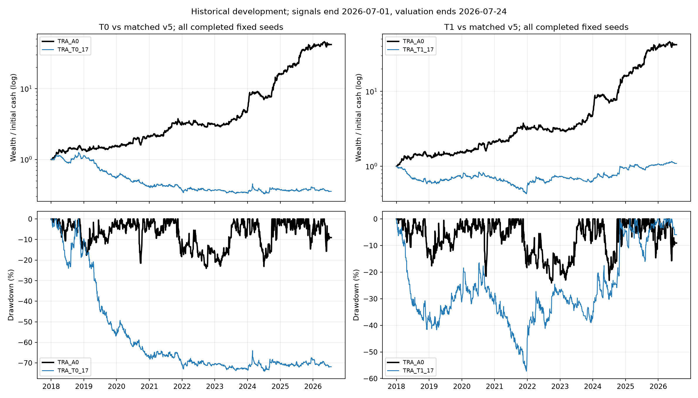

# D4 TRA — D4_COMPLETE

公开旧作者实现参考与A股目标回测分开。作者参考两阶段完整默认停止结果见reference/original_benchmark_results.csv；原作者切片可跨股票的已知缺陷保留披露，公开参考不是目标PIT证明。目标数据按股票边界、真实成熟时间及独立预测期队列适配。

目标使用原作者LSTM/TRA/Gumbel/Sinkhorn OT/MSE；六通道数据维度适配、batch1形状兼容及相同冻结权重均值的精确恒等兼容均有源码SHA和失败证据。500epoch上限/20验证早停/100batch上限不变。T0/T1同一共享预训练骨干，保持完全冻结；只改变1/10预测头和原TRA/OT机制，不归因于骨干升级。

训练梯度仅使用切分截止前成熟标签，验证保留所有D日已知节点、仅对成熟标签计指标。每次验证和年度Outer预测均独立冷启动队列；Outer不携带训练内拟合误差作为历史OOF。专家输出在预测时保存，仅在真实退出成熟后反馈，并保留作者21观测排除规则。

输入覆盖、无交易报价处理、完整2010起预热和短历史零padding见target_data。信号截止2026-07-01；2018-01-02..2026-07-24均为已反复开发的历史期，初始现金300000，最后时段是估值/退出尾段。正式v5不变并单列；主要对照补齐655个真实可预测键，旧38003键分数精确一致。覆盖差异不计TRA贡献。

S0实际结果：

```csv
experiment_id,CAGR,Sharpe,MaxDD,TerminalNAV,trades
TRA_A0,0.5472179501652976,1.864664983388517,-0.24056327715394388,12556911.983064711,1116
TRA_T0_17,-0.1142858815773814,-0.6328047656497418,-0.740188536320582,106212.69234747876,1221
TRA_T1_17,0.009852470102901467,0.1459262434652108,-0.572332033889851,326250.5111793014,1228
TRA_T0_42,-0.03901285566609458,-0.1892120214335623,-0.47348164529707193,213430.55283177795,1189
TRA_T1_42,-0.014164372643018397,0.010855197146662296,-0.4504897298192695,265530.2322122022,1239
TRA_T0_73,-0.10510293520831948,-0.5324955621313622,-0.6864666333984997,116011.80641320939,1237
TRA_T1_73,-0.1858438508376985,-1.1864168157182033,-0.8366616933849139,51660.155844957924,1183
TRA_FORMAL_V5,0.5499812832273525,1.8756627913361064,-0.24056327715394388,12750089.355724689,1107
```



全部S1/S2、年度收益、费用/滑点、敞口/换手、真实Top1/Top2净PnL、人民币NAV桥、最差63日/UI/ES95、配对Bootstrap和SPA见结果表。S3为原执行器已有开盘封板拒单约束，实际拒单身份见S3_identity_evidence.csv，不复制成绩冒充新实验。T1相对T0的同成本结果和独立配对检验见paired_T1_vs_T0；不可把T1相对v5的全部变化都算成路由贡献。

原有符号经济门逐项结果见economic_decisions.csv/json；不放宽门槛、不挑选历史赢家、不自动晋升。全部三个种子独立报告。完整冷拟合与真实Outer未来/未成熟标签回放见counterfactual_tests，尚未完成的seed和测试以STATUS为准。

完整Outer另做当时不可用标签删除，不永久删除之后已合法成熟的反馈。订单反事实调用原Stock完整账户：一个原始S0加六个冷拟合标签变体，共七个诊断配置；全部overlay计划输入、成交、拒单、持仓、袖套、现金流、费用及NAV须精确一致，并再次对照主要TRA_T1_17实际NAV。独立登记于counterfactual_tests/native_order_replays，SPA明示相同路径别名，不冒充新alpha备择或七个新经济候选。

模型、预测和实测资源见target_models与worker_profiles，原始大输入仅提供路径/schema/字节SHA清单，不上传私人面板。训练内输出不冒称历史OOF；工程合成fixture不计真实模型。所有早期失败和澄清保留。供应商历史修订、legacy D+1开盘缺口/日内高低价成交与零公司行动覆盖限制仍保留，不声称独立未用测试或实盘证明。

CURRENT_BASELINE_CHANGED=FALSE
PRODUCTION_CONFIG_CHANGED=FALSE


D4最终验收（2026-11-19T22:00:47.842127+00:00）：作者原公开基准两个完整阶段已结束；目标域三固定seed17/42/73共162个完整常规模型，加12个完整冷启动反事实模型，合计174。六个早/中/晚×Five/Ten完整反事实案例均严格通过，七个原生诊断账户订单/账本完全一致。24个实际经济配置（18个候选成本配置、3个匹配基准、3个正式v5控制）及完整风险、配对Bootstrap、SPA、人民币归因和实际净值图已生成。原生诊断账户另计7个，不作为7个新策略。六个T0/T1×seed候选全部REJECT_CURRENT_CONFIGURATION；缺证据门未被改成通过。匹配TRA_A0 S0 CAGR/Sharpe/MaxDD=0.5472179502/1.8646649834/-0.2405632772；正式v5旧锚点为0.5499812832/1.8756627913/-0.2405632772，二者因资格覆盖不同分账。

|模型|CAGR|Sharpe|MaxDD|
|---|---:|---:|---:|
|TRA_T0_17|-0.1142858816|-0.6328047656|-0.7401885363|
|TRA_T1_17|0.0098524701|0.1459262435|-0.5723320339|
|TRA_T0_42|-0.0390128557|-0.1892120214|-0.4734816453|
|TRA_T1_42|-0.0141643726|0.0108551971|-0.4504897298|
|TRA_T0_73|-0.1051029352|-0.5324955621|-0.6864666334|
|TRA_T1_73|-0.1858438508|-1.1864168157|-0.8366616934|

T1在seed17/42优于对应T0，在seed73反而更差，不能选择赢家seed或声称路由稳定有效。所有候选相对匹配基准均未通过收益、风险和成对成本方向门；当前TRA配置归档，不升级baseline，不扩路由/骨干/参数搜索。2018–2026仍为开发期walk-forward，既存v5的D+1缺口和历史fill限制保留；本轮测试不构成全供应商历史PIT或实盘成交证明。原公开基准旧版跨股票切片风险、一次未复现的单批次内存精确断言失败、旧CPU2参考尝试和中断/恢复的具体证据均保留，不抹去。

D4源码、测试、成绩、主报告、manifest和权限清单已自动推送8d4583fae34cfa5aab7936a08a05702599ef4a93，5116个远端工件逐项一致。完整证据见D4/REPORT.md、D4/all_results.csv、D4/economic_decisions.csv与D4/STATUS.json。D4无外部阻断，CURRENT_BASELINE_CHANGED=FALSE，PRODUCTION_CONFIG_CHANGED=FALSE。D5尚未启动，下一步按原规范完成MASTER冻结、原公开参考和M0/M1真实OOF入模路径，不因TRA失败而跳过。
